  

I'm Mohammed, a full-stack developer and Computer Science student at Taif University
(class of 2027). I build web apps with React, TypeScript, Node.js / NestJS and ASP.NET
Core, and I like taking them past localhost to the people who use them.

**[Portfolio](https://mohammed-portfolio-iota.vercel.app)** ·
**[LinkedIn](https://www.linkedin.com/in/mohammed-al-gorashi-454844372/)**

## Projects

- **MazajChef POS**: an Arabic, tablet-first restaurant point-of-sale (PWA, offline-first)
  with a cloud print relay to an ESC/POS thermal printer, taken from architecture to
  on-site deployment. The source is private; the write-up is on my portfolio.
- **Shifa clinic booking**: a bilingual React + Vite frontend and a layered ASP.NET Core
  Web API with JWT auth and SQL Server.
  [Frontend](https://github.com/ABUsahraj/Clinic-Management-Frontend) ·
  [Backend](https://github.com/ABUsahraj/Clinic-Management-Backend)
- **MazajChef secure network**: a Cisco Packet Tracer design with six VLANs,
  router-on-a-stick, guest DHCP and a guest-isolation ACL.
  [Repository](https://github.com/ABUsahraj/MazajChef-Secure-Network-)
- **TU Landmark**: a 2D OpenGL / FreeGLUT scene of a Taif University landmark.
  [Repository](https://github.com/ABUsahraj/TU-Landmark-OpenGL)

During my internship at MOHTAWA I worked on Abrim, an AI contract editor (React,
TypeScript, NestJS, PostgreSQL, Prisma). I also lead the team behind RASD, a heart-rate
session analysis assistant and a SAIF 2026 finalist.

## Get in touch

I'm open to full-stack and software engineering roles and internships. The quickest way to
reach me is a message on [LinkedIn](https://www.linkedin.com/in/mohammed-al-gorashi-454844372/).
